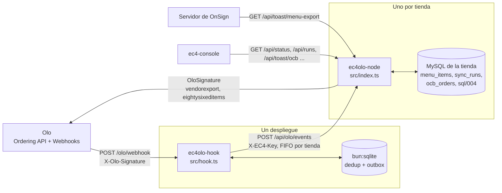
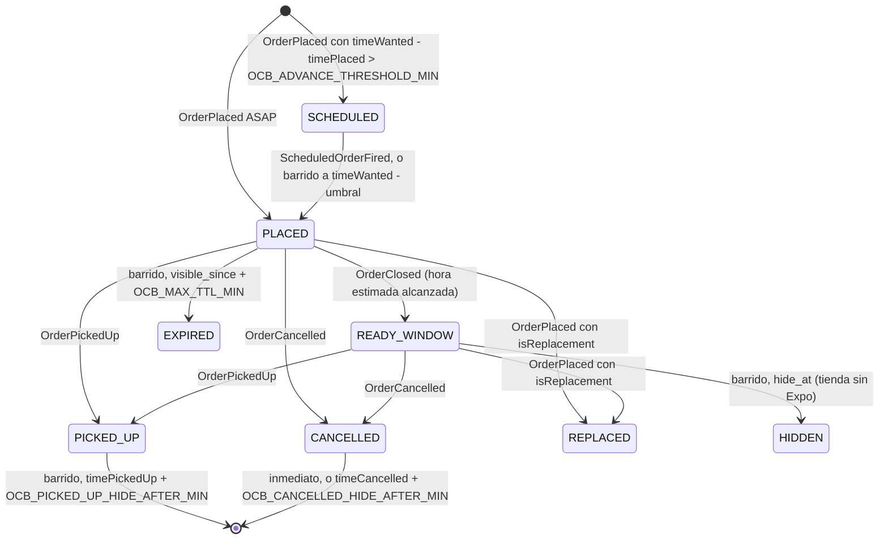

# Arquitectura

## Componentes

- **ec4olo-hook** es delgado: firma, dedup, outbox, ack y entrega. No tiene logica de negocio.
- **ec4olo-node** es el gemelo de ec4toast-node: mismo contrato MySQL y HTTP, con Olo como fuente.

## Mapa de archivos

| ec4toast-node | ec4olo-node | Cambio |
| --- | --- | --- |
| src/index.ts | src/index.ts + src/app.ts + src/logger.ts + src/contenedor.ts | Mismo arranque; la app y el logger se separan para los tests y el receptor |
| src/config/menuConfig.ts | igual | Copia sin cambios |
| src/config/runtime.ts | igual + src/config/olo.ts | `SYNC_INTERVAL_MS` (alias `TOAST_SYNC_INTERVAL_MS`), `STATUS_SIDE`; config de Olo y OCB validada |
| src/middleware/serviceAuth.ts | igual | Copia sin cambios |
| src/services/toastApi.service.ts | src/services/oloApi.service.ts | Signature Authorization, backoff ante 429/5xx, 301 seguido a mano, zip |
| src/services/menuSync.service.ts | igual | importar, reconciliar, tick; getMenuExport identico |
| src/services/menuFlatten.service.ts | igual + vendorExport.parser.ts | aplanarVendorExport, fusionarOchentaYSeis, recolectarCategorias |
| src/services/menuDiff.service.ts | igual | Copia; solo cambia el import del tipo de fila |
| src/services/menuItem.service.ts | igual | hayQueFrenar y borrarAusentes; el acceso a datos va a src/almacen |
| src/services/changeLog.service.ts, syncRun.service.ts | iguales | Misma logica, persisten via Almacen; entradaStock nuevo |
| src/services/schema.service.ts | igual | Usa el PrismaClient compartido |
| (nuevo) | src/almacen/ | Interfaz Almacen, AlmacenPrisma (MySQL), AlmacenMemoria (tests y mock) |
| (nuevo) | src/services/availability.service.ts | Deltas de MenuItemAvailabilityChanged y pendientes |
| (nuevo) | src/services/storeHealth.service.ts | VendorAvailabilityChanged y VendorTemporarilyDisabled |
| (nuevo) | src/services/oloEvents.service.ts | Enrutador de eventos dentro del node |
| src/services/ocb.service.ts, ocbFormat.service.ts | iguales en forma | Alimentados por webhooks; maquina de estados en ocb.service |
| (no existia) | src/services/oloWebhook.service.ts | Firma X-Olo-Signature, ruteo |
| (nuevo) | src/hook.ts, src/hook/ | Receptor central |
| sql/001 a 003 | iguales + sql/004_create_olo_tables.sql | olo_webhook_events, ocb_olo_state, olo_pending_availability |

## Rutas HTTP

Mismo contrato que ec4toast-node, incluido el prefijo `/api/toast/`.

| Ruta | Auth | Que hace |
| --- | --- | --- |
| `GET /health` | abierta | Healthcheck del contenedor |
| `GET /api/toast/menu-export` | X-EC4-Key | Lo que consume OnSign. `?soldOutIconUrl`, `?withCount=true` -> `{ totalItems, items }` |
| `POST /api/toast/menu-export/sync` | X-EC4-Key | Importacion manual (export + linea base) |
| `POST /api/toast/menu-export/reconcile` | X-EC4-Key | **Nueva.** Solo la linea base de 86 |
| `GET /api/status`, `GET /api/runs` | X-EC4-Key | Semaforo e historial de ciclos |
| `GET /api/toast/menu-changes` | X-EC4-Key | Historial de cambios (`?posId`, `?limit`) |
| `GET /api/toast/menu-categories` | X-EC4-Key | Categorias y optiongroups del export, con `kind` |
| `GET /api/toast/ocb` | X-EC4-Key | Board (`?businessDate`, `?restaurantId`) |
| `POST /api/toast/scheduler/pause`, `POST .../resume`, `GET .../status` | X-EC4-Key | Scheduler |
| `GET /api/logs` | X-EC4-Key | 500 lineas en memoria |
| `GET /api/toast/test-authentication` | X-EC4-Key | Prueba la firma contra `vendorexport/status` |
| `GET /api/toast/vendor-export-status` | X-EC4-Key | Depuracion: reemplaza a `menus-v2` |
| `GET /api/toast/eightysixed` | X-EC4-Key | Depuracion: reemplaza a `inventory` |
| `GET /api/toast/restaurant-info` | X-EC4-Key | Depuracion: `GET /restaurants/{id}` de Olo |
| `POST /api/olo/events` | X-EC4-Key | Entrada desde el receptor (body crudo) |

`GET /api/toast/orders` (ordersBulk de Toast) no tiene equivalente: con Olo no hay pull de ordenes.

Receptor: `POST /olo/webhook` (o `/olo/webhook/{brand}`), `GET /healthz`, `GET /metrics`.

## Maquina de estados del OCB

| Estado | Rango | Fila en ocb_orders | status visible |
| --- | --- | --- | --- |
| SCHEDULED | 0 | no (snapshot en board_snapshot) | - |
| PLACED | 1 | si | OCB_PLACED_STATUS (IN_PREPARATION) |
| READY_WINDOW | 2 | si | READY si OCB_SHOW_READY_ON_CLOSED |
| PICKED_UP | 3 | hasta hide_at | READY, o PICKED_UP con OCB_EXTENDED_STATUS |
| CANCELLED | 3 | no, o hasta hide_at | CANCELLED con OCB_EXTENDED_STATUS |
| REPLACED, EXPIRED, HIDDEN | 3 | no | - |

- El estado nunca baja de rango. Un evento de rango 3 no se reabre.
- Cualquier evento trae el Order completo y crea la fila si el anterior no llego.
- `CustomerArrived` guarda `arrived_at`. `OrderAdjusted` y `ScheduledOrderFailed` solo se registran.
- Las horas salen del payload convertidas con `storeTimeZone`, nunca de `X-Olo-Timestamp`. Un evento terminal tardio cuyo hide_at ya paso nunca aparece.
- Reemplazo: la original se borra. Si todavia no llego, queda una lapida (`REPLACED`) que se busca por `order_guid` y por `order_id_string`.
- `deliveryMethod` fuera de `OCB_DELIVERY_METHODS`: estado HIDDEN, nunca se muestra.
- El INSERT en `olo_webhook_events` y el cambio de estado van en una transaccion.
